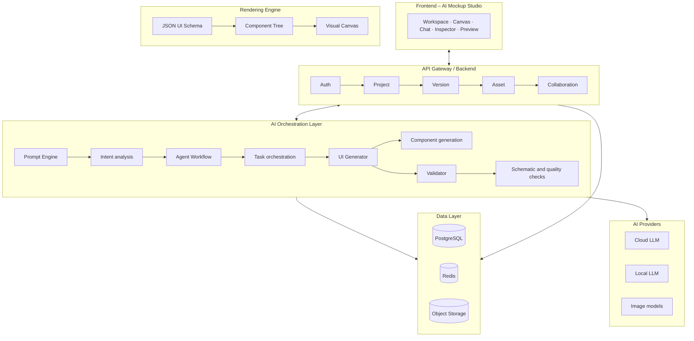
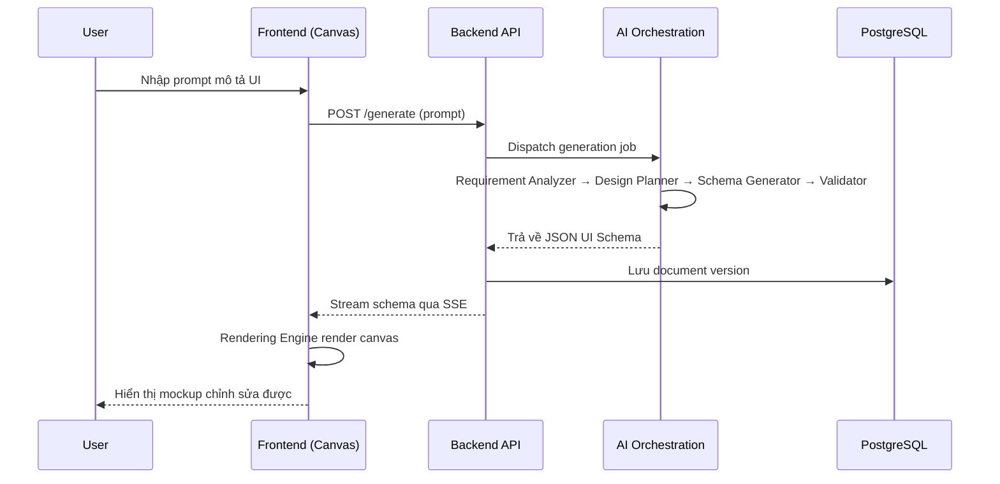

# 02 — Kiến trúc tổng quan (High-level architecture)

> Nguồn: mục #2 của hội thoại ChatGPT + phân tích mở rộng.

---

## Chiến lược kiến trúc

Đề xuất kiến trúc **modular monolith** ở backend ban đầu, kết hợp:
- **Frontend component-based**
- **AI orchestration layer độc lập**

> Lý do: MVP chưa cần microservices (xem [11-what-not-to-do.md](./11-what-not-to-do.md)), nhưng cần tách biệt rõ các module để dễ mở rộng.

---

## System architecture

**Chú thích các tầng:**

| Tầng | Thành phần chính |
|------|-----------------|
| **Frontend** | Workspace · Canvas · Chat · Inspector · Preview |
| **API Gateway / Backend** | Auth · Project · Version · Asset · Collaboration |
| **AI Orchestration Layer** | Prompt Engine · Intent analysis · Agent Workflow · UI Generator · Validator |
| **Data Layer** | PostgreSQL · Redis · Object Storage |
| **AI Providers** | Cloud LLM · Local LLM · Image models |
| **Rendering Engine** | JSON UI Schema → Component Tree → Visual Canvas |

Các hoạt động: **Events, streaming, persistence** — nối xuyên suốt hệ thống.

---

## Điểm kiến trúc quan trọng nhất

> AI **không nên trực tiếp sinh và thực thi code tùy ý trong canvas**.

Thay vào đó:
1. AI sinh ra một **cấu trúc dữ liệu UI có schema xác định** (JSON UI Schema).
2. **Renderer của ứng dụng** chịu trách nhiệm hiển thị cấu trúc đó.

### Lợi ích

- ✅ Kiểm soát được component được sinh ra.
- ✅ Dễ chỉnh sửa từng thành phần.
- ✅ Hỗ trợ Undo/Redo.
- ✅ Lưu version và compare.
- ✅ Tránh việc AI sinh code không an toàn.
- ✅ Dễ dàng chuyển đổi sang nhiều framework.

---

## 💡 Phân tích & mở rộng

### Luồng dữ liệu đề xuất

### Vì sao modular monolith cho MVP?

- **Đơn giản để triển khai và debug.**
- **Vẫn rõ ràng module boundaries** — sau này tách thành service độc lập khi cần scale.
- AI orchestration được thiết kế như một module với interface rõ ràng để dễ nâng cấp.

### Điểm cần chốt

1. Backend có stream kết quả AI qua **SSE** hay có job queue (BullMQ) xử lý bất đồng bộ? (Đề xuất: kết hợp — queue để chạy job, SSE để stream về client).
2. Việc **persistence** versioning document nằm ở backend ngay từ đầu hay chỉ local-first? (Xem [08-project-structure.md](./08-project-structure.md) và [10-database-design.md](./10-database-design.md)).
