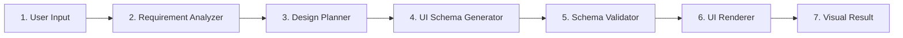

# 04 — AI Generation Pipeline

> Nguồn: mục #4 của hội thoại ChatGPT + phân tích mở rộng.

---

## Nguyên tắc quan trọng nhất

> ⚠️ **Không nên gửi prompt của người dùng trực tiếp vào LLM rồi lấy HTML trả về.**

Thay vào đó, chia thành một **pipeline có kiểm soát** — đây là phần cần thiết kế cẩn thận nhất của toàn bộ hệ thống AI.

---

## Text-to-UI Pipeline



| Bước | Stage | Nhiệm vụ |
|------|-------|----------|
| 1 | **User Input** | Ví dụ: *"Create a CRM dashboard for sales team"* |
| 2 | **Requirement Analyzer** | Extract intent, page type, user role, layout, features và constraints |
| 3 | **Design Planner** | Tạo page structure, component hierarchy, design tokens và responsive rules |
| 4 | **UI Schema Generator** | Generate structured JSON theo UI schema |
| 5 | **Schema Validator** | Validate schema, component types, properties và references |
| 6 | **UI Renderer** | Resolve components và render UI trong canvas |
| 7 | **Visual Result** | Editable UI mockup và responsive preview |

### Chi tiết từng bước

#### 1. User Input
- Người dùng nhập yêu cầu bằng ngôn ngữ tự nhiên.
- Ví dụ: *"Create a CRM dashboard for sales team."*

#### 2. Requirement Analyzer
- Trích xuất **ý định** (intent).
- Xác định **loại trang** (page type), **vai trò người dùng** (user role).
- Liệt kê **layout mong muốn**, **tính năng** và **ràng buộc** (constraints).

#### 3. Design Planner
- Tạo **page structure** (cấu trúc trang).
- Xây dựng **component hierarchy** (thứ bậc component).
- Định nghĩa **design tokens** (màu sắc, typography, spacing).
- Đặt **responsive rules** (cách giao diện thích ứng với breakpoints).

#### 4. UI Schema Generator
- Sinh **structured JSON** khớp với UI schema (xem [05-ui-schema.md](./05-ui-schema.md)).
- Kết quả là dữ liệu UI chứ không phải HTML/CSS.

#### 5. Schema Validator
- Kiểm tra schema có hợp lệ không.
- Kiểm tra component types, properties và references (IDs) có tồn tại.
- (Retry nếu không hợp lệ — xem [09-architecture-considerations.md](./09-architecture-considerations.md) → AI reliability).

#### 6. UI Renderer
- Resolve components từ registry.
- Render UI trong canvas.

#### 7. Visual Result
- Mockup có thể chỉnh sửa.
- Preview responsive (desktop/tablet/mobile).

---

## Cơ chế cập nhật (Patch-based editing)

Khi người dùng yêu cầu sửa một phần nhỏ:

> *"Change the sidebar width to 300px."*

AI **chỉ cần tạo một patch** — không cần sinh lại toàn bộ trang:

```json
// AI Patch (ví dụ)
{
  "operation": "update",
  "targetId": "main-sidebar",
  "changes": {
    "props.width": 300
  }
}
```

- **Renderer** nhận patch và cập nhật component.
- Không cần sinh lại toàn bộ trang.
- Đây là một trong những quyết định **ảnh hưởng lớn đến khả năng mở rộng** của sản phẩm.

---

## 💡 Phân tích & mở rộng

### Vì sao pipeline cần "validate + retry"?

- LLM có thể sinh JSON không hợp lệ hoặc tham chiếu component/ID không tồn tại.
- Không nên mặc định AI sinh ra kết quả đúng chỉ vì response trả về **HTTP 200**.
- Cần: Schema validation, Component registry, Reference validation, Patch validation, Retry strategy, Rollback, Generation evaluation. (Chi tiết tại [09-architecture-considerations.md](./09-architecture-considerations.md) → 8.3 AI reliability.)

### Đề xuất mở rộng cho pipeline (ngoài hội thoại gốc)

1. **Streaming output** — stream từng phần schema về để người dùng thấy "đang vẽ" thay vì chờ toàn bộ.
2. **Structured output / JSON mode** — ép model trả về JSON đúng định dạng (nếu provider hỗ trợ).
3. **Tool calling** — cho phép AI gọi các tool như `list_components`, `register_asset` để hợp lệ hóa trong quá trình sinh.
4. **History / context** — đưa lịch sử hội thoại + document hiện tại vào context → giúp AI hiểu ngữ cảnh chính xác hơn.
5. **Evaluation** — thu thập phản hồi "generation có đúng ý không" để đánh giá chất lượng model theo thời gian.
