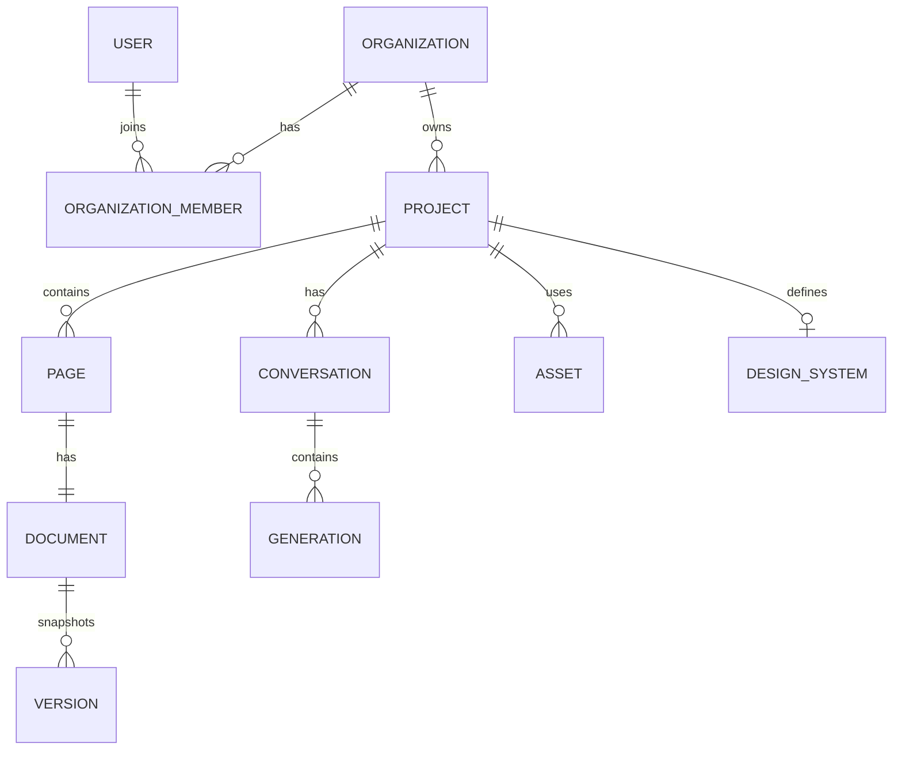

# 10 — Database Design (Thiết kế cơ sở dữ liệu sơ bộ)

> Nguồn: mục #9 của hội thoại ChatGPT + phân tích mở rộng.

---

## Các entity chính

| Entity | Purpose |
|--------|---------|
| **User** | Người dùng |
| **Organization** | Workspace/team |
| **Project** | Dự án |
| **Page** | Các trang trong dự án |
| **Document** | UI schema |
| **Component** | Component metadata hoặc registry reference |
| **DesignSystem** | Design tokens |
| **Asset** | Images, icons, files |
| **Conversation** | AI conversations |
| **Generation** | AI generation jobs |
| **Version** | Document snapshots |
| **Export** | Export history |

---

## ER Diagram

---

## Lưu ý quan trọng

> 💡 **Component không nhất thiết phải là bảng database.**

Ban đầu có thể dùng **component registry trong source code** và chỉ lưu **component type, ID, properties** trong JSON document. Điều này giảm phức tạp và tăng tốc MVP.

---

## 💡 Phân tích & mở rộng

### Đề xuất chi tiết từng bảng (khởi điểm)

| Bảng | Cột đề xuất | Ghi chú |
|------|-------------|---------|
| `users` | id, email, name, avatar_url, created_at | Auth qua backend |
| `organizations` | id, name, slug, owner_id | — |
| `organization_members` | org_id, user_id, role | role: owner/admin/member/viewer |
| `projects` | id, org_id, name, description, created_by | — |
| `pages` | id, project_id, name, order, document_id | Một page có một document |
| `documents` | id, page_id, schema (jsonb), schema_version, updated_at | **JSONB** chứa UI schema |
| `versions` | id, document_id, snapshot (jsonb), created_by, created_at | Snapshot cho version history |
| `conversations` | id, project_id, title, created_by | Lịch sử hội thoại AI |
| `generations` | id, conversation_id, prompt, result, provider, model, status, created_at | Đánh giá/trace |
| `assets` | id, project_id, type, url, metadata | Images, icons, files |
| `design_systems` | id, project_id, tokens (jsonb), name | Design tokens |
| `exports` | id, project_id, type, status, url, created_by | History export |
| `ai_providers` / `ai_models` | — | Xem chi tiết tại [14-custom-ai-provider.md](./14-custom-ai-provider.md) |

### Những điểm cần lưu ý cho MVP

1. **Lưu UI schema dưới dạng JSONB** trong `documents` — đúng khuyến nghị (không dùng MongoDB).
2. **Version history:** cân nhắc lưu full snapshot (đơn giản, replay dễ) vs diff (tiết kiệm dung lượng). MVP có thể dùng full snapshot, nâng cấp sau.
3. **Component registry** nằm trong source code (package `ui-schema`) — DB chỉ lưu tham chiếu.
4. **Soft delete** cho project/page để rollback dễ khi đang phát triển sản phẩm sớm.

### Mở rộng (Phase Enterprise)

- **Permissions / RBAC:** bảng `permissions`, `roles` (Phase 4).
- **Comments / review:** bảng `comments`, `reviews` (Phase 4).
- **Collab:** bảng thao tác thời gian thực nếu cần (Phase 2+).
