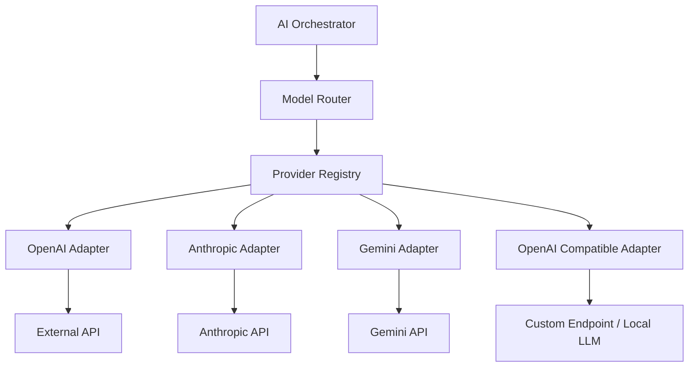
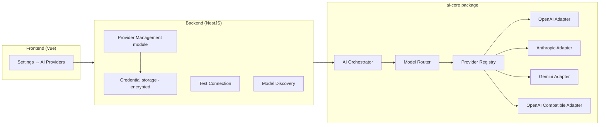

# 14 — Custom AI Provider (API Key / Base URL / Model)

> Nguồn: message 6 của hội thoại ChatGPT (trả lời "có thể custom provider như: apikey, baseurl và model đúng không?") + phân tích mở rộng.

---

## Trả lời trực tiếp

> ✅ **Hoàn toàn được.** Thậm chí đây là một **tính năng kiến trúc quan trọng ngay từ đầu**: **Custom AI Provider Configuration**.
>
> Người dùng tự cấu hình **API Key**, **Base URL** và **Model** — tương tự như **OpenCode, LiteLLM** hoặc các công cụ AI coding hỗ trợ custom provider.

---

## 1. Provider configuration UI

Ví dụ trong **Settings → AI Providers**:

```text
AI Provider Settings (Custom Provider)
─────────────────────────────────────
Provider Name   [ Input default value: My Local LLM ]
Provider Type
  - OpenAI Compatible
  - Anthropic Compatible
  - Google Gemini
  - Custom HTTP API
Base URL        [ Input default value: http://localhost:8080/v1 ]
API Key         [ Input value hidden ]
Model           [ Input default value: qwen3.5-9b ]
Test connection before saving (Connected)
[ Test Connection ]
```

> Minh họa cấu hình provider, không phải kết nối API thực tế.

---

## 2. Các provider nên hỗ trợ

| Provider | Base URL | API Key | Model |
|----------|----------|---------|-------|
| **OpenAI** | Customizable | ✅ Yes | Select/input |
| **Anthropic** | Customizable | ✅ Yes | Select/input |
| **Gemini** | Customizable | ✅ Yes | Select/input |
| **OpenAI Compatible** | Customizable | Optional | Input |
| **llama.cpp** | Local endpoint | Optional | Input |
| **Ollama** | Local endpoint | Optional | Input |
| **MLX Server** | Local endpoint | Optional | Input |
| **Custom** | Customizable | Configurable | Input |

### Hệ thống tương thích nhờ **OpenAI Compatible**

- llama.cpp
- LM Studio
- vLLM
- LiteLLM
- LocalAI
- OpenRouter
- Các gateway hoặc proxy tự triển khai.

---

## 3. Architecture — Provider Adapter Pattern

### Sơ đồ



### Ví dụ TypeScript interface

```typescript
interface AIProviderConfig {
  id: string;
  name: string;
  type: "openai" | "anthropic" | "gemini" | "custom";

  baseURL: string;
  apiKey?: string;

  models: AIModelConfig[];
  enabled: boolean;
}

interface AIModelConfig {
  id: string;
  name: string;

  capabilities: {
    textGeneration: boolean;
    vision: boolean;
    streaming: boolean;
    structuredOutput: boolean;
    toolCalling: boolean;
  };
}
```

> ⚠️ **Lưu ý:** Không nên giả định mọi OpenAI-compatible endpoint đều hỗ trợ đầy đủ **Vision, Tool Calling hoặc Structured Output**. Cần **kiểm tra capability thực tế** (ví dụ: qua `/models` endpoint hoặc test call).

---

## 4. Database structure

Đề xuất **tách Provider và Model**:

```text
AI Configuration
│
├── Providers
│   ├── Provider A
│   │   ├── Base URL
│   │   ├── API Key (encrypted)
│   │   └── Models
│   │       ├── Model 1
│   │       └── Model 2
│   │
│   └── Provider B
│       ├── Base URL
│       ├── API Key (encrypted)
│       └── Models
│
└── Default Model Routing
    ├── UI Generation
    ├── UI Editing
    ├── Image Understanding
    └── Design Analysis
```

**Chi tiết bảng đề xuất (mở rộng):**

- `ai_providers`: id, user_id/org_id, name, type, base_url, api_key_encrypted, enabled.
- `ai_models`: id, provider_id, model_id, name, capabilities (jsonb).
- `ai_routing` (default model routing): task_type (UI_GENERATION/UI_EDITING/IMAGE_UNDERSTANDING/DESIGN_ANALYSIS), provider_id, model_id, fallback_provider_id.

---

## 5. Một số tính năng nâng cao nên có

- ✅ **Test Connection** — Kiểm tra endpoint, authentication và model.
- ✅ **Model Discovery** — Tự động lấy danh sách model nếu API hỗ trợ.
- ✅ **Default Provider** — Chọn provider mặc định.
- ✅ **Task-based Routing** — Mỗi tác vụ dùng model khác nhau.
- ✅ **Fallback Provider** — Nếu model chính lỗi thì chuyển sang model dự phòng.
- ✅ **Usage Tracking** — Token usage, latency, request count.
- ✅ **Temperature / Max Tokens** — Cấu hình generation.
- ✅ **Custom Headers** — Hỗ trợ proxy hoặc gateway đặc biệt.

---

## 6. Lưu ý bảo mật quan trọng

### Nếu ứng dụng có backend cloud

- ✅ API Key phải được **mã hóa** khi lưu.
- ✅ **Không trả API Key** về frontend sau khi lưu.
- ✅ **Không để API Key trong localStorage**.
- ✅ **Không log API Key**.
- ✅ **Kiểm soát SSRF** khi người dùng nhập Base URL, đặc biệt với endpoint nội bộ.
- ✅ Có **timeout** và **giới hạn response size**.

### Nếu hỗ trợ local LLM

> Nên cho phép kết nối **trực tiếp đến local endpoint** trong môi trường **self-hosted**, thay vì mặc định đưa mọi request qua cloud backend.

---

## Khuyến nghị cuối cùng

> 💡 Hãy xây dựng **AI Provider Management** thành một **module độc lập ngay từ MVP**.
>
> - Đừng để logic OpenAI, Anthropic hay llama.cpp nằm rải rác trong AI Generator.
> - Như vậy sau này có thể thêm **bất kỳ provider mới nào** mà không phải thay đổi **UI Schema Engine** hay **Rendering Engine**.

---

## 💡 Phân tích & mở rộng

### Ảnh hưởng kiến trúc khi đưa custom provider vào MVP



### Cách triển khai hợp lý

1. **Module `ai/core` (NestJS):** quản lý provider config, test connection, routing.
2. **Package `ai-core` (chia sẻ):** interface `AIProviderConfig`, `AIModelConfig`, adapter giao tiếp provider.
3. **Encryption:** dùng AES-256-GCM (hoặc dịch vụ KMS) để mã hóa API key; chỉ decrypt khi gọi provider ở backend.
4. **Security layer:** SSRF protection (chặn private IP ranges / localhost khi baseURL từ user — trừ khi user là admin/self-host), allowlist giao thức http/https, timeout mặc định.
5. **Test Connection:** gọi một request nhỏ (vd: list models hoặc chat 1 câu) để xác nhận endpoint + auth + model hoạt động, trả kết quả "Connected".

### Câu hỏi mở

1. Provider config áp dụng cho **per-user** hay **per-organization**? (Mỗi đáp án kéo theo schema & permission khác nhau.)
2. Có cần **proxy server** chuyển tiếp request AI để giấu API key hay cho phép client gọi trực tiếp? (Đề xuất: trung gian qua backend — dễ kiểm soát, tracking, SSRF filter.)
3. **Model Discovery** qua `/v1/models` — có chuẩn hóa response format không? (Không hẳn toàn bộ endpoint đều giống OpenAI.)
